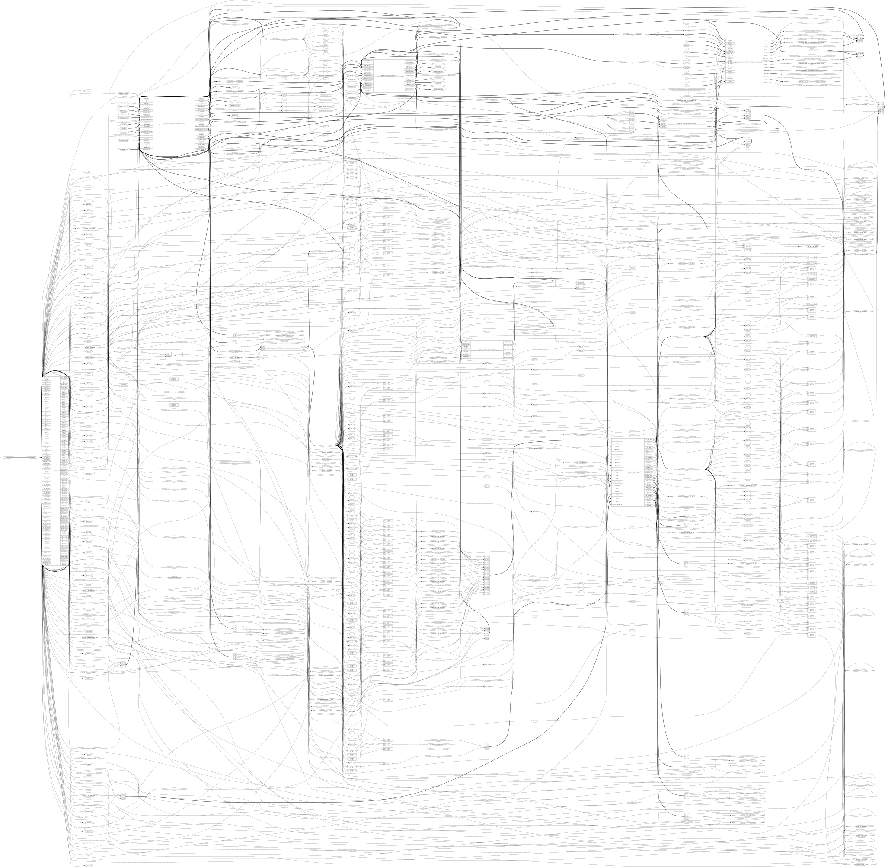
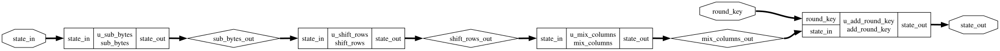

# AES-128 Accelerator in X-HEEP

This repository contains AES-128 RTL artifacts and the Nangate45 physical-design results for the flattened `xheep_top` SoC design.
The flattened X-HEEP input is based on the [upstream X-HEEP project](https://github.com/x-heep/x-heep). Its Solderpad Hardware License is included as [`LICENSE-XHEEP`](LICENSE-XHEEP); individual IP blocks may have additional licensing terms.

## Repository layout

```text
rtl/aes_core/                         Standalone AES core RTL
tb/aes_core/                          AES core testbench
docs/images/                          Generated Yosys schematic diagrams
physical_design/nangate45/xheep/
  openroad/                           Inputs and configuration for the X-HEEP run
    gds/                              Final GDSII (Git LFS)
    logs/                             KLayout merge log
    metrics/                          OpenROAD stage metrics
    reports/                          Final and synthesis reports
scripts/                              Flow launcher
```

## Nangate45 X-HEEP physical design

The reported run used the Nangate45 platform, top module `xheep_top`, a 10 ns clock target, a 2500 x 2500 um die, and a 20..2480 um core. The flattened design and SRAM wrapper are in [`physical_design/nangate45/xheep/openroad/`](physical_design/nangate45/xheep/openroad/).

| Metric | Result |
|---|---:|
| Standard-cell area | 110,337 um^2 |
| Core utilization | 1.82% |
| Final reported power | 21.84 mW |
| Detailed-route wire length | 1,190,208 um |
| Detailed-route vias | 408,636 |
| Detailed-route DRC errors | 0 |
| Antenna net / pin violations | 0 / 0 |
| Final max-slew / max-cap violations | 104 / 13 |

Power is an OpenROAD estimate from the final report, not a workload-based power simulation. The final timing report found no timing paths, so the 10 ns target is **not** evidence of timing closure; WNS/slack are not meaningful for this run.

### GDS limitations

The final GDS is [`6_final.gds`](physical_design/nangate45/xheep/openroad/gds/6_final.gds). The Nangate45 fakeram macro has no physical GDS in this platform and is allowed as an empty cell. The SRAM geometry is therefore a placeholder; this GDS is not a complete SRAM implementation or tapeout-ready layout.

### Re-running the flow

Install OpenROAD-flow-scripts with its Nangate45 platform, GNU Make, and the required Yosys and OpenROAD executables on `PATH`. Then run:

```bash
export ORFS_ROOT=/path/to/OpenROAD-flow-scripts
./scripts/run_nangate45_xheep.sh
```

The flow writes generated files under `build/openroad/`. Override `WORK_HOME` or `NUM_CORES` if desired. The final GDS in this repository was produced with OpenROAD 26Q3-904-geaaa6e36cb and KLayout 0.30.9.

To fetch the large GDS after cloning:

```bash
git lfs install
git lfs pull
```

## Schematic diagrams

### X-HEEP top-level netlist



### AES core


### AES round


